  Desarrollador Full Stack junior en el bootcamp de The Bridge. 
  Hago webs con React y APIs con Node, NestJS y PostgreSQL.

  
  

 

## Proyectos destacados

| Proyecto | Qué es | Con qué | Probarlo |
| :-- | :-- | :-- | :-- |
| [Rastro (web)](https://github.com/jbalaguersalas/Rastro-con-React) | Web de compraventa de segunda mano: listado con filtros, ficha del anuncio y formulario para publicar. Conectada a mi API | React, TypeScript, Redux Toolkit | [Demo](https://rastro-jbalaguer.netlify.app) |
| [API Rastro](https://github.com/jbalaguersalas/api-rastro) | La API de la web de Rastro: anuncios y ofertas, cada parte en su rama con pull requests | Express, TypeScript, MongoDB | [Datos](https://api-rastro-lo94.onrender.com/api/listings) |
| [API gimnasio FitVal](https://github.com/jbalaguersalas/api-gimnasio-fitval) | API de un gimnasio: planes, horario de clases y login con JWT, con permisos por rol, tests e2e y lint en cada pull request | NestJS, PostgreSQL, JWT | [Swagger](https://api-gimnasio-fitval.onrender.com/docs) |
| [Furniro](https://github.com/migueldonaire/furniro-bootcamp-fullstack) | Tienda de muebles en equipo con toda la clase, con Jira y revisión de pull requests. Yo hice añadir al carrito y la página del carrito ([mi PR](https://github.com/migueldonaire/furniro-bootcamp-fullstack/pull/37)) | React, Redux Toolkit, NestJS | En equipo |
| [Libros y pedidos](https://github.com/jbalaguersalas/nestjs-postgresql-supabase-render) | Partí del código de clase y le añadí los pedidos y los ejercicios del tema | NestJS, PostgreSQL, Supabase | |

> Las APIs están en Render: la primera petición puede tardar un minuto si estaban dormidas.

 

## Prácticas y ejercicios de clase

| Práctica | Qué hice | Con qué |
| :-- | :-- | :-- |
| [Maqueta de Figma en Docker](https://github.com/jbalaguersalas/-Pr-ctica-Docker-Web-Minimalista) | Pasé a HTML y CSS un diseño de Figma, empezando por el móvil, y lo metí en un contenedor con nginx | HTML, CSS, Docker |
| [Ejercicios de TypeScript](https://github.com/jbalaguersalas/Bikram-typescript) | Veinte ejercicios de tipos, interfaces, clases y genéricos | TypeScript |
| [Varita mágica](https://github.com/jbalaguersalas/DOM-varita-magica) | Al pasar el ratón o hacer click, cambian las imágenes y los colores de la página | JavaScript, DOM |
| [Peticiones a APIs](https://github.com/jbalaguersalas/JS-Asynchronous-code) | Ejercicios de `fetch` y async/await con la Dog API y la API de GitHub | JavaScript |
| [Currículum web](https://github.com/jbalaguersalas/web-cv) | Completé en HTML y CSS una plantilla de Figma que dejó empezada el profesor | HTML, CSS |
| [Modelo SQL del gimnasio](https://github.com/jbalaguersalas/Proyecto-SQL-Gimnasio) | Las tablas de un gimnasio y consultas con JOIN | SQL, PostgreSQL |

 

## Lo que he tocado

 

## Mis tres meses en The Bridge

**Septiembre.** Git, HTML y CSS: ramas, merges, mis primeros conflictos y un currículum sacado de Figma.
**Octubre.** JavaScript, DOM y TypeScript, ejercicios con tests de Jasmine y una web metida en Docker.
**Noviembre.** SQL y MongoDB, después Express y NestJS, login con JWT y lint con GitHub Actions.
**Ahora.** React con Redux Toolkit: la web de Rastro conectada a mi propia API, y Furniro, una tienda de muebles que hacemos entre toda la clase.
