  Estoy empezando en el desarrollo web con el bootcamp Full Stack de The Bridge. 
  Uso mucho la IA para aprender: me explica los errores y me ayuda cuando me atasco.

  
  

 

## Prácticas del bootcamp

| Práctica | Qué hice | Con qué |
| :-- | :-- | :-- |
| [Maqueta de Figma en Docker](https://github.com/jbalaguersalas/-Pr-ctica-Docker-Web-Minimalista) | Pasé a HTML y CSS un diseño de Figma, empezando por el móvil, y lo metí en un contenedor con nginx | HTML, CSS, Docker |
| [Ejercicios de TypeScript](https://github.com/jbalaguersalas/Bikram-typescript) | Veinte ejercicios de tipos, interfaces, clases y genéricos | TypeScript |
| [API gimnasio FitVal](https://github.com/jbalaguersalas/api-gimnasio-fitval) | API de un gimnasio: planes, horario de clases y login con JWT | NestJS, PostgreSQL, JWT |
| [Varita mágica](https://github.com/jbalaguersalas/DOM-varita-magica) | Al pasar el ratón o hacer click, cambian las imágenes y los colores de la página | JavaScript, DOM |
| [API Rastro](https://github.com/jbalaguersalas/api-rastro) | API de compraventa de segunda mano, cada parte en su rama con pull requests | Express, TypeScript, MongoDB |
| [Peticiones a APIs](https://github.com/jbalaguersalas/JS-Asynchronous-code) | Ejercicios de `fetch` y async/await con la Dog API y la API de GitHub | JavaScript |
| [Currículum web](https://github.com/jbalaguersalas/web-cv) | Completé en HTML y CSS una plantilla de Figma que dejó empezada el profesor | HTML, CSS |
| [Libros y pedidos](https://github.com/jbalaguersalas/nestjs-postgresql-supabase-render) | Partí del código de clase y le añadí los pedidos y los ejercicios del tema | NestJS, PostgreSQL |
| [Modelo SQL del gimnasio](https://github.com/jbalaguersalas/Proyecto-SQL-Gimnasio) | Las tablas de un gimnasio y consultas con JOIN | SQL, PostgreSQL |

 

## Lo que he tocado

 

## Mis tres meses en The Bridge

**Septiembre.** Git, HTML y CSS: ramas, merges, mis primeros conflictos y un currículum sacado de Figma.
**Octubre.** JavaScript, DOM y TypeScript, ejercicios con tests de Jasmine y una web metida en Docker.
**Noviembre.** SQL y MongoDB, después Express y NestJS, login con JWT y lint con GitHub Actions.
**Ahora.** Sigo con el bootcamp y practicando por mi cuenta.
